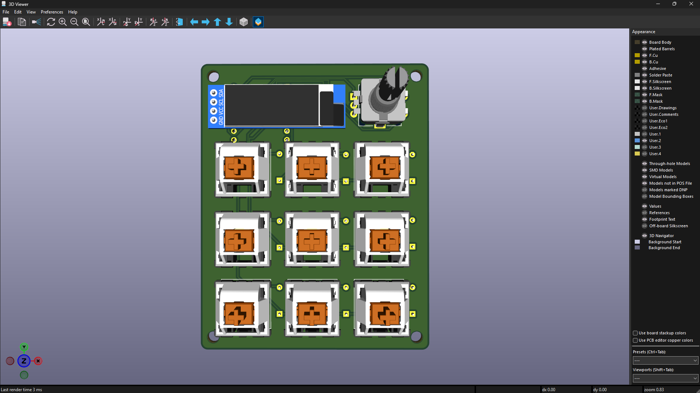

# PiPad

### A custom 3×3 mechanical macropad built from scratch.


## About

PiPad is a 3x3 macropad that I designed and build myself.It features 9 mechnical keys, a rotary encoder and an OLED display(128x32).

I started this project to get into Electronics and to learn PCB design , 3D CAD modelling and embedded firmware dev.

## Features

- 9 mechnical keys
- Rotary encoder
- OLED display 128x32
- 4 profiles
- 36 macros
- Custom QMK firmware

## Design

### PCB Design

Designed using KiCad





### 3D Enclosure

The enclosure was made in Fusin 360. I went through multiple versions to reduce the overall size and achieved a cleaner and minimal design.
It includes mounting points, a type C opening 


## Firmware

PiPad uses [QMK Firmware](https://github.com/qmk/qmk_firmware).

The firmware is configured with four profiles, each containing nine key positions, giving a total of 36 configurable macro positions.

The default key layout uses the F13–F21 key range.

```text
┌─────┬─────┬─────┐
│ F13 │ F14 │ F15 │
├─────┼─────┼─────┤
│ F16 │ F17 │ F18 │
├─────┼─────┼─────┤
│ F19 │ F20 │ F21 │
└─────┴─────┴─────┘
```

The firmware currently compiles successfully. Physical hardware testing is still pending.


## Development Journal

I documented the dev process, including the mistakes, redesigns and time spent on each process

**[Read the Development Journal →](JOURNAL.md)**


## Credits & Resources

- [QMK Firmware](https://github.com/qmk/qmk_firmware) – Keyboard firmware framework.
- [Joe Scotto's ScottoKicad](https://github.com/joe-scotto/scottokeebs/tree/main/Extras/ScottoKicad) – KiCad assets and resources used during PCB design.

## Author

**Piyush Rajbanshi**

- Email: [hi@piyushrajbanshi.com.np](mailto:hi@piyushrajbanshi.com.np)

## License

This project is licensed under the [MIT License](LICENSE).
